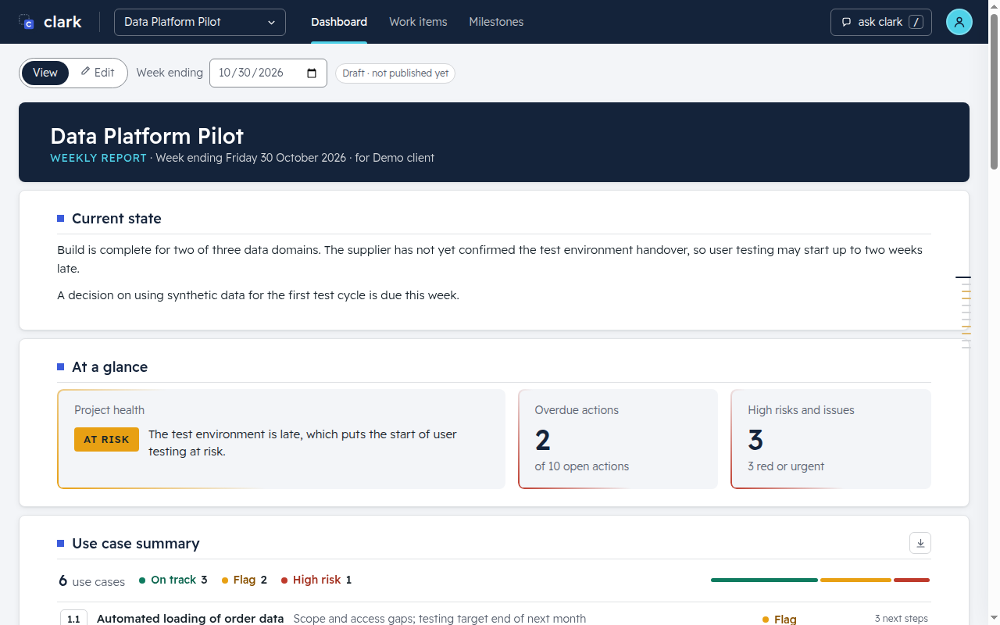
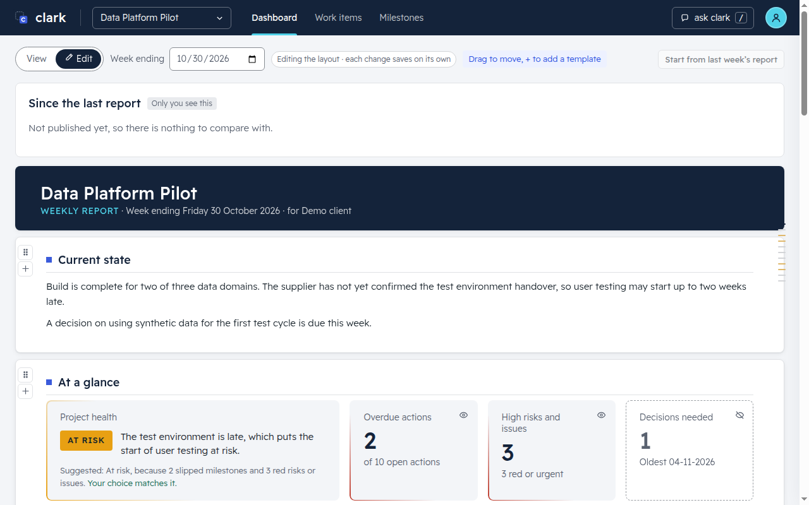
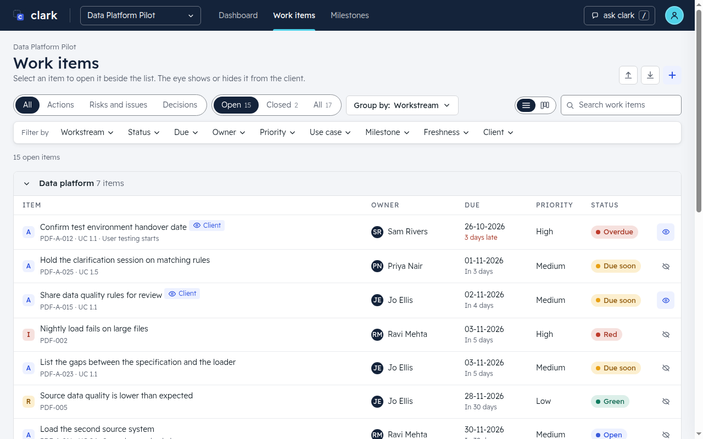
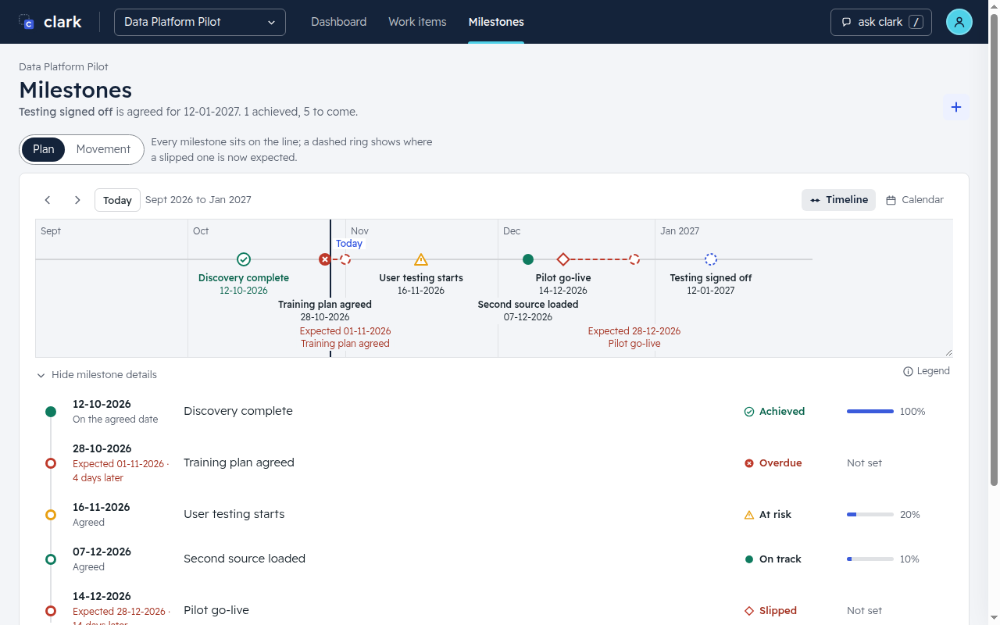
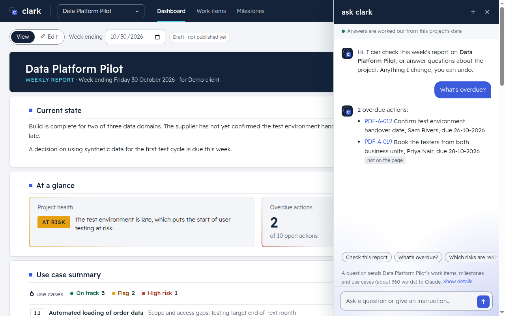
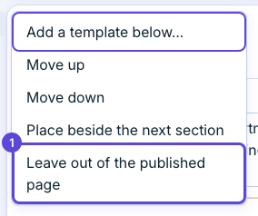
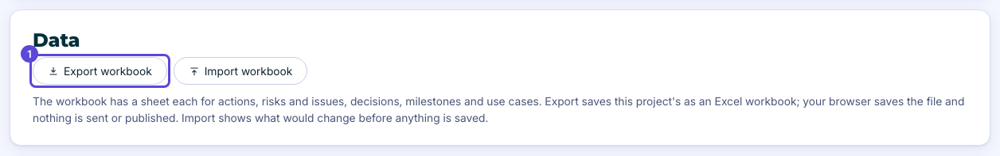
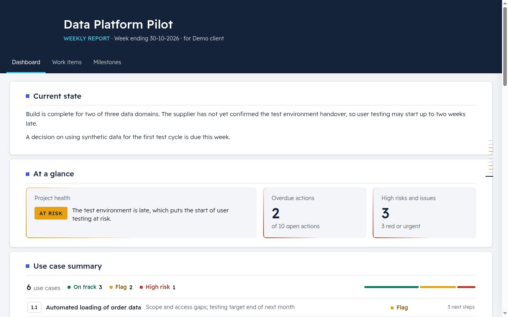

# clark

**The weekly project report, written from the work itself.**

This is a report editor for programme managers. It keeps a project's actions, risks, issues, decisions, milestones and use cases in one place on your own computer, with a history and Undo. You can move them in and out of Excel, and publish the weekly report as one web page you can send to a client. Your data stays on your computer. It goes only where you send it: a published report, an Excel or Word file you save, a backup folder you choose, or, when you ask clark a question, the passages it needs go to the Claude or ChatGPT you connected.

> **Beta.** This is the 1.0 build. It is still marked Beta because updating from inside clark is not switched on yet: install a new version by downloading it and replacing the old one. It works and is tested, but expect rough edges and changes between versions. It runs on a Mac today. Windows and Linux downloads come later.

## What you can do with it

### Write the weekly report

Write it where you read it: switch between View and Edit, add and move sections, change a status, owner or date in place, and Undo anything.

### Keep the log

Actions, risks, issues and decisions, each with an owner, a due date and a history. Read them as a table or as a board.

### Track milestones

See them on a timeline or a calendar, with a slipped date shown against the agreed one.

### Ask clark

Ask a question about your project, or give an instruction, in plain words. Connect Claude or ChatGPT in Settings first. Press `/` when you are not typing in a box, or use the **ask clark** button in the top bar. Asking is switched on from the start and you can switch it off in Settings; nothing is sent until you ask. The passages it needs go to the Claude or ChatGPT you connected. Anything it changes, you can undo.

### Choose what the client sees

Each item and section can be left out of the published page with one click.

### Work with Excel

Import a spreadsheet you already have, and export your work items, milestones and use cases back out.

### Publish

Publish as a single web page. It opens anywhere, with no server and no sign-in.

## Two ways to start clark

Download the latest `clark-…-mac.zip` from this repository's **Releases** page and unzip it. You then start clark in one of two ways. Both use the same program and the same pages.

**Double-click.** Open the folder called `clark` and double-click `clark.command`. This needs Python 3.9 or newer. Google Chrome works best. The file `START-HERE.md` explains the prompts your Mac may show the first time.

**Docker.** If your Mac will not open `clark.command`, or you would rather not use Python on your computer, install Docker, open Terminal in the unzipped `clark` folder and type `docker compose -f docker/compose.yaml up -d`. Then open http://localhost:8766. To stop it, type `docker compose -f docker/compose.yaml down`. Only your own computer can reach it. `START-HERE.md` has the same steps, with more detail.

**Check that your computer is ready.** Open Terminal in the unzipped `clark` folder (type `cd` and a space, drag the folder into the window and press Return), then type `bash clark.command --check`. It tells you what to fix, if anything, and where to get it.

To look around with made-up projects first, open Terminal in the folder and type `bash clark.command --demo --open`. Nothing you do there is kept.

## The clark folder

The download unzips to one folder called `clark`. Its program files are inside a hidden folder called `.app`, so what you see is only what you use: `README.md`, `START-HERE.md`, `clark.command`, `clark-release.json` and `docker`. If you add your own logo or colours, they go in a folder called `branding`, which clark never changes. The first time clark 1.0.6 starts, it copies a folder called `system/branding` from an older clark into `branding`, if `branding` has nothing in it yet; the old folder is left as it is. If you already have a folder called `clark`, rename or move it before you unzip a newer download, so the two do not clash. Your projects are not in that folder. In clark 1.0, updating from inside clark is switched off, so install a newer version by hand: close clark, rename the old folder, unzip the new download and double-click `clark.command`. `START-HERE.md` has the full steps.

## Where your data lives

**Double-click.** Your data stays on your computer, in `~/Library/Application Support/clark/`. That folder holds your database (`clark.db`), clark's safety copies (in a `backups` folder beside it) and a log file.

**Docker.** Your data is in the data folder that Docker shares with clark. By default that is `~/Library/Application Support/clark/`, the same place as the double-click route, so both show the same projects. It is not inside the `clark` folder, so you can swap that folder for a newer download without losing anything. If your data is in a `data` folder inside an old `clark` folder, move it out before you delete the old folder, or name it in `CLARK_DATA_DIR`.

For both:

- **Keep it out of OneDrive, Dropbox and any other synced folder.** They can damage a database that is open.
- **Never open the same data from `clark.command` and from Docker at the same time.** Stop one before you start the other. By default they use the same data.
- **Safety copies** are made before every Undo, before every Excel import and once a day. The newest 14 are kept. Settings › Backups lists them and puts one back. If clark will not start, close it and type `bash clark.command restore` in Terminal to see them.
- **A copy off this computer.** In Settings › Backups, type a folder into **Copy my backups to** (a folder in OneDrive is fine). Each finished backup is also put there, and the same number is kept. It is off until you choose one. To read from it, close clark and type `bash clark.command restore --from FOLDER` in Terminal.

To keep your data somewhere else, start clark with `bash clark.command --data FOLDER`. With Docker, put the folder's full path in quotes in `CLARK_DATA_DIR` in front of the command: `CLARK_DATA_DIR="/full/path" docker compose -f docker/compose.yaml up -d`. A folder inside OneDrive cannot be used.

## If something goes wrong

Open an issue on this repository and say what you did, what you expected and what you saw. For a security problem, do not open an issue: email alan@januscollab.com (the steps are in `SECURITY.md`). If clark says it did not start, it names a log file (`server.log` in the data folder): please attach it. Do not attach your database or any real client information.

## For people who build clark

- **Run the tests:** `python3 dev/run_tests.py`.
- **The generated pages are not committed (#495).** `src/clark/page/page.html` and `page-view.html` are git-ignored. `python3 dev/tools/build_page.py` makes them; CI, `dev/run_tests.py`, `dev/tools/package.py` and a source start of clark build them when missing or older than the sources (a server builds at start; a source edited while it runs is not rebuilt, so restart the server). If an old branch still carries them, refresh it with `dev/tools/merge_main.sh`, or by hand: in the merge run `git rm src/clark/page/page.html src/clark/page/page-view.html`, fix the real source conflicts, then rebuild with `python3 dev/tools/build_page.py`.
- **The page-file merge driver (#228) is not used.** Main no longer tracks the built pages, so for a branch that still carries them the conflict is "changed here, deleted on main", which a merge driver does not settle. `dev/tools/install_merge_driver.py` and `merge_page.py` stay in the tree only for an old clone that already set it up (`python3 dev/tools/install_merge_driver.py --uninstall` removes it). `python3 dev/tools/build_page.py --check` (also run by `tests/test_one_editor_gate.py`) fails when a committed page is not what the sources give.
- `docs/PROJECT-BRIEF.md` says what clark is for.
- `docs/ARCHITECTURE.md` and `docs/handoff/` say how it is built and why.
- `docs/RULES.md` lists the rules the project follows: no real names or client data, plain words, British English.
- the reuse record lists the code it builds on, with where each part comes from.

All data in this repository is fictional demo data.

## Licence

You may read the code, and download and run clark on computers that you or your employer own, for your own work, including reports you make for your employer or your clients. You may not copy it, change it, or build on it without permission. The full words are in `LICENSE`. To ask for permission, write to alan@januscollab.com.
